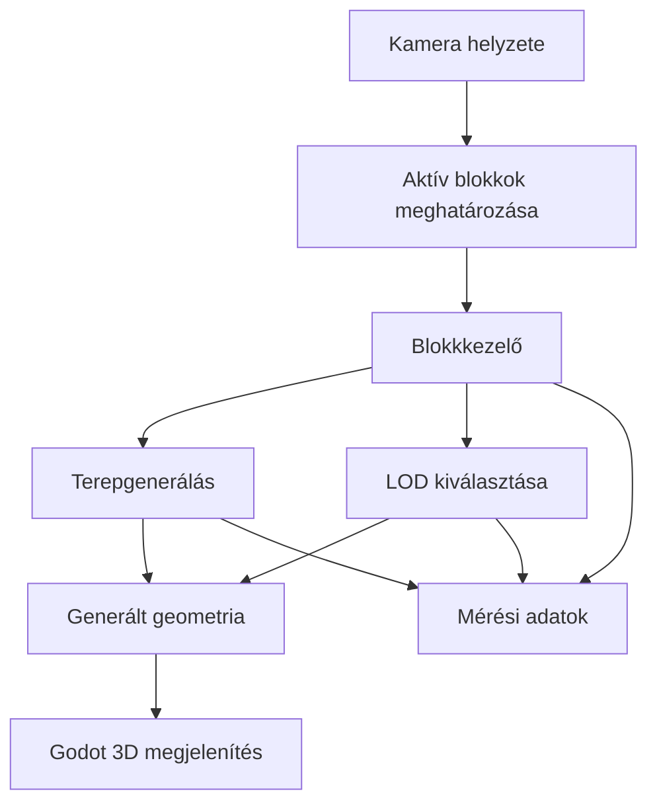

# Valós idejű procedurális terepgenerálás és a részletességi szintek kezelése

## 1. Szereplők és jogosultságok

| Szerep | Igény | Felelősség / hozzáférés |
| --- | --- | --- |
| Fejlesztő / hallgató | A terepgeneráló rendszer megvalósítása és vizsgálata | A rendszer fejlesztése, tesztelése, mérése és dokumentálása. |
| Témavezető | A szakmai munka és eredmények áttekintése | A fejlesztés és a dokumentált eredmények szakmai értékelése.|

## 2. Use case-ek / user storyk

### Procedurális terep megjelenítése és bejárása

- **Szereplő:** Fejlesztő / tesztelő
- **Előfeltétel:** A program elindult, és a terepgeneráláshoz szükséges beállítások rendelkezésre állnak.
- **Fő folyamat:**
  1. A felhasználó elindítja a programot.
  2. A rendszer létrehozza a kamera környezetében a szükséges terepblokkokat.
  3. A kamera mozgásakor a rendszer meghatározza, mely blokkokat kell betölteni, frissíteni vagy eltávolítani.
  4. A rendszer a saját LOD-szabályai alapján meghatározza az egyes blokkok részletességét.
  5. A felhasználó megfigyelheti a terepet, és módosíthatja a vizsgálathoz szükséges paramétereket.
  6. A rendszer megjeleníti, illetve a vizsgálat során ellenőrizhetővé teszi a különböző részletességű szomszédos blokkok közötti átmeneteket és az esetlegesen megjelenő hézagokat.
- **Alternatív / hibafolyamatok:** Ha egy blokk generálása vagy betöltése késik, a rendszernek kezelnie kell a feldolgozás elhúzódását. A fokozatos vagy aszinkron feldolgozás pontos módját a megvalósítás során kell meghatározni.
- **Utófeltétel:** A kamera környezetében a szükséges terepblokkok megjelennek, a már nem szükséges blokkok pedig a meghatározott szabályok szerint eltávolításra kerülnek.

### Terepgeneráló algoritmusok összehasonlítása

- **Szereplő:** Fejlesztő / tesztelő
- **Előfeltétel:** Legalább két terepgeneráló algoritmus és a mérési paraméterek rendelkezésre állnak.
- **Fő folyamat:**
  1. A felhasználó kiválasztja a vizsgálandó terepgeneráló algoritmust.
  2. A rendszer a beállított paraméterek alapján létrehozza a terepet.
  3. A mérés rögzíti a generálási időt, a CPU- és képkockaköltséget, a memóriahasználatot, a generált geometria méretét és a blokkbetöltési késleltetést.
  4. A mérést a másik algoritmussal is elvégzik, lehetőség szerint azonos körülmények és beállítások mellett.
  5. Az eredményeket dokumentálják, majd összehasonlítják a teljesítmény és a vizuális minőség szempontjából.
- **Alternatív / hibafolyamatok:** Ha a mérési körülmények vagy a beállítások eltérnek, az eltéréseket dokumentálni kell. Ha a mérés nem értékelhető, azonos feltételek mellett meg kell ismételni.
- **Utófeltétel:** A két algoritmus mérési eredményei dokumentált és összehasonlítható formában rendelkezésre állnak.

## 3. Funkcionális követelmények

| Követelmény | Elfogadási kritérium | Prioritás |
| --- | --- | --- |
| A rendszer procedurális terepet generál. | A program a beállított paraméterek alapján terepgeometriát hoz létre és jelenít meg. | Kötelező |
| A rendszer a terepet külön kezelhető blokkokra bontja. | A blokkok egymástól függetlenül létrehozhatók és eltávolíthatók. | Kötelező |
| A rendszer a kamera helyzete alapján kezeli a blokkokat. | A kamera mozgatásakor a szükséges blokkok betöltődnek, a már nem szükségesek pedig eltávolításra kerülnek. | Kötelező |
| A rendszer saját LOD-kiválasztást alkalmaz. | A blokkok részletessége a dokumentált saját szabályok alapján változik a kamera helyzetétől vagy távolságától függően. | Kötelező |
| Legalább két terepgeneráló algoritmus összehasonlítható. | Mindkét algoritmus ugyanazon mérési feltételek és összehasonlítható paraméterek mellett futtatható, eredményeik pedig rögzíthetők. | Kötelező |
| A rendszer kezeli a fokozatos vagy aszinkron feldolgozást. | A blokkok generálása és kezelése fokozatosan vagy aszinkron módon történik, és a megoldás működése dokumentált. | Kötelező |
| A rendszer lehetővé teszi a mérési paraméterek változtatását. | A látótávolság, a kameramozgás, a terep mérete, a blokkfelbontás, az aktív blokkok száma, a LOD-küszöbök és a generálás összetettsége a program beállításaiban vagy a mérési esetekben változtatható, illetve rögzíthető. | Kötelező |
| A rendszer támogatja a teljesítményméréseket. | Rögzíthető a generálási idő, a CPU-terhelés vagy -feldolgozási költség, a képkockaidő vagy képkockasebesség, a memóriahasználat, a generált geometria mérete és a blokkbetöltési késleltetés. | Kötelező |
| A rendszer lehetővé teszi az eredmények összehasonlítását. | A két algoritmus mérési eredményei azonosított mérési feltételekkel dokumentálhatók és összehasonlíthatók teljesítmény, memóriaigény és vizuális minőség alapján. | Kötelező |
| A rendszer vizsgálja a terep geometriai vagy vizuális eltéréseit. | A választott módszerrel a releváns geometriai vagy vizuális eltérések mérhetők vagy megfigyelhetők, az alkalmazott módszer és az eredmények pedig dokumentáltak. | Kötelező |
| A program reprodukálható módon futtatható. | A forráskód, a szükséges futtatási lépések és a mérési beállítások dokumentáltak, így a fő funkciók és a mérések megismételhetők.| Kötelező |

Prioritás: **Kötelező** = a teljesítéshez szükséges; **Ajánlott** = fontos, de a megvalósítás részleteitől függhet; **Lehetséges** = idő esetén opcionális.

## 4. Üzleti szabályok és korlátok

| Szabály vagy korlát | Indoklás |
| --- | --- |
| A terepgenerálás, a blokkkezelés és a LOD-kiválasztás központi logikáját saját megoldásként kell megvalósítani. | A projekt szakmai hozzájárulása nem épülhet kizárólag a játékmotor automatikus terep- vagy LOD-rendszerére. |
| Az összehasonlított algoritmusokat azonos vagy megfelelően összehangolt mérési feltételek mellett kell vizsgálni. | Ez szükséges az ismételhető és értelmezhető mérésekhez. |
| A különböző megközelítések összehasonlításakor a többi beállítást lehetőség szerint változatlanul kell tartani. | Így jobban elkülöníthető a vizsgált módszer hatása. |
| A mérések körülményeit és a használt paramétereket dokumentálni kell. | Az eredmények később megismételhetők és ellenőrizhetők legyenek. |
| A látható rések és a LOD-átmenetek problémáját kezelni vagy mérhető módon elemezni kell. | Ez a témakiírás egyik kiemelt követelménye. |
| A teljes nyílt világú játék és a hozzá tartozó játékmeneti funkciók nem részei a projektnek. | A munka a tereprendszer működésére és vizsgálatára összpontosít. |

## 5. Felhasználói felület és munkafolyamat

A program elsődleges felülete egy 3D-s nézet, amelyben a kamera mozgatható, és a procedurálisan generált terep megfigyelhető. A programnak lehetőséget kell biztosítania a fontosabb generálási és LOD-paraméterek módosítására, valamint a vizsgált terepgeneráló algoritmus kiválasztására és tesztelésére.

A mérési munkafolyamat során a felhasználó beállítja a vizsgálati paramétereket, kiválasztja a vizsgált algoritmust, majd elindítja a generálást vagy a mérést. Az eredményeket rögzíti, dokumentálja, majd az azonos vagy megfelelően összehangolt mérési feltételek mellett kapott eredményeket összehasonlítja.

A felhasználói felület pontos kialakítása és a kezelési lehetőségek részletei a prototípus elkészítése során véglegesíthetők.

## 6. Nem funkcionális követelmények

| Követelmény | Ellenőrzés módja |
| --- | --- |
| A program a dokumentált fejlesztői környezetben elindítható. | A projekt tiszta indításának ellenőrzése a README alapján. |
| A terep frissítése kamera mozgása közben mérhető teljesítmény mellett történik. | A képkockaidő és a frissítésekhez kapcsolódó feldolgozási költség mérése kamera mozgatása közben. |
| A mérési eredmények reprodukálhatók. | Azonos beállítások mellett végzett ismételt futtatások eredményeinek összehasonlítása, a mérési körülmények dokumentálásával. |
| A rendszer teljesítménye és memóriaigénye mérhető. | A generálási idő, a CPU-terhelés vagy -feldolgozási költség, a képkockaidő vagy képkockasebesség, a memóriahasználat, a geometria mérete és a blokkbetöltési késleltetés rögzítése. |
| A különböző LOD-szintek közötti vizuális átmenetek vizsgálhatók. | A szomszédos blokkok határainak megfigyelése és dokumentálása eltérő LOD-beállítások mellett. |
| A forráskód és a fejlesztési döntések követhetők. | A Git-verziótörténet, a projektleírás és a mérési dokumentáció ellenőrzése. |

A konkrét teljesítménycélokat a kezdeti prototípus és a fejlesztői hardver ismeretében célszerű meghatározni, hogy azok reálisak és mérhetők legyenek.

## 7. Nyitott kérdések és kockázatok

| Kérdés / kockázat | Hatás | Felelős | Feloldás / döntés |
| --- | --- | --- | --- |
| Melyik két terepgeneráló algoritmust hasonlítsam össze? | Meghatározza a rendszer felépítését és a mérési tervet. | Hallgató | A lehetséges algoritmusok áttekintése és megvalósíthatóságuk vizsgálata után kiválasztani a két módszert. |
| Milyen szabály alapján választja ki a rendszer a LOD-szintet? | Befolyásolja a vizuális minőséget és a teljesítményt. | Hallgató | A kezdeti távolságalapú megoldás és egy eltérő stratégia összehasonlításának megvizsgálása. |
| Hogyan történjen az aszinkron vagy fokozatos generálás Godotban? | A rosszul szervezett feldolgozás képkockakimaradást vagy késleltetést okozhat. | Hallgató | Kis prototípussal megvizsgálni, mely munkafolyamatok végezhetők biztonságosan a háttérben. |
| Hogyan kezelhetők a különböző LOD-szintű szomszédos blokkok határai? | Látható rések vagy hirtelen geometriai átmenetek keletkezhetnek. | Hallgató | A lehetséges átmenetkezelési módszerek prototipizálása és vizsgálata. |
| Hogyan kezelhetők a különböző LOD-szintű szomszédos blokkok határai? | Látható rések vagy hirtelen geometriai átmenetek keletkezhetnek. | Hallgató | A lehetséges átmenetkezelési módszerek prototipizálása és vizsgálata. |
| Hogyan mérhető megbízhatóan a memóriahasználat és a geometria mérete? | Az összehasonlítás pontossága és értelmezhetősége függ tőle. | Hallgató | A mérhető adatok és a Godot által biztosított eszközök felmérése. |
| Milyen teljesítményt nyújt a rendszer nagyobb terepméretek és eltérő beállítások mellett? | A demonstrátor méretezhetősége korlátozott lehet. | Hallgató | A terep méretének, a blokkfelbontásnak, a látótávolságnak és az aktív blokkok számának változtatásával tesztelni. |

## 8. Kezdeti technikai javaslat

### Javasolt megoldás

A kezdeti terv a Godot játékmotorra és a GDScript programozási nyelvre épül. A terepgenerálás, a blokkok kezelése és a LOD-szint kiválasztása saját kóddal valósul meg. A Godot biztosítja a 3D-s megjelenítést, a kamera kezelését és az általános projektinfrastruktúrát.

A fejlesztés először egyetlen generált terepblokkal indul. Ezt követi a kamerához igazodó dinamikus blokkkezelés, majd a saját LOD-rendszer kialakítása, a szomszédos blokkok közötti átmenetek vizsgálata és a mérési funkciók megvalósítása. Ezt követően kerül sor a két terepgeneráló algoritmus összehasonlítására.

### Technológiai irány

| Terület | Jelölt technológia / megközelítés | Megfontolás oka | Nyitott kérdés / kockázat |
| --- | --- | --- | --- |
| Játékmotor | Godot | 3D-megjelenítés és általános játékfejlesztési infrastruktúra | A generált geometria és a sok blokk teljesítményét prototípussal kell ellenőrizni. |
| Programozási nyelv | GDScript | A Godothoz illeszkedő fejlesztési nyelv | A nagyobb generálási feladatok teljesítményét mérni kell. |
| Terepreprezentáció | Blokkokra bontott generált geometria | A blokkok külön generálhatók, frissíthetők és eltávolíthatók. | A blokkfelbontást és a blokkok közötti átmenetek kezelését meg kell határozni. |
| LOD-kiválasztás | Saját, paraméterezhető mechanizmus | Lehetővé teszi a részletességi szintek szabályozását. | A konkrét LOD-szabályokat meg kell határozni. |
| Terepgenerálás | Két összehasonlítandó terepgeneráló algoritmus | A generálási teljesítmény, a memóriaigény és a vizuális minőség összehasonlítása. | A konkrét algoritmusokat ki kell választani. |
| Feldolgozás | Fokozatos vagy aszinkron blokkfeldolgozás | Mérsékelheti a generálás fő szálra gyakorolt hatását. | A Godotban alkalmazható biztonságos feldolgozási módot ellenőrizni kell. |
| Verziókezelés | Git és GitHub | A forráskód, a dokumentáció és a fejlesztési lépések követése. | A mérési eredmények tárolási formáját meg kell határozni. |
| Mérés és dokumentáció | Rögzített tesztbeállítások és eredménytáblák | Az összehasonlítások ismételhetőségének biztosítása. | A mérőszámokat és a teszteseteket pontosítani kell. |

### Kezdeti architektúravázlat

### Megvalósíthatóság és technikai kockázatok

| Kockázat / feltételezés | Validáció | Tartalék megközelítés |
| --- | --- | --- |
| Egy terepblokk megfelelő sebességgel generálható. | Egyetlen blokk generálási idejének és geometriájának mérése több felbontással. | Egyszerűbb terepfüggvény vagy kisebb kezdeti felbontás használata. |
| A dinamikus blokkkezelés a kamera mozgásához igazítható. | A blokkok betöltésének és eltávolításának tesztelése egyszerű kameramozgással. | Kevesebb aktív blokk vagy kisebb látótávolság használata. |
| A LOD-szintek közötti látható átmenetek vizsgálhatók és kezelhetők. | Szomszédos blokkok vizsgálata különböző részletességi szinteken. | A hibák mérhető dokumentálása és egyszerűbb átmenetkezelési módszer kipróbálása. |
| A generálás fokozatosan vagy aszinkron módon végrehajtható. | A generálás fő szálra gyakorolt hatásának összehasonlítása. | A feldolgozás kisebb lépésekre bontása és a blokkok korlátozott ütemű előállítása. |
| A két terepgeneráló algoritmus eredményei érdemben összehasonlíthatók. | Azonos vagy megfelelően összehangolt terepparaméterek és mérési körülmények mellett végzett tesztek. | Kevesebb, de jól kontrollált teszteset alkalmazása. |
