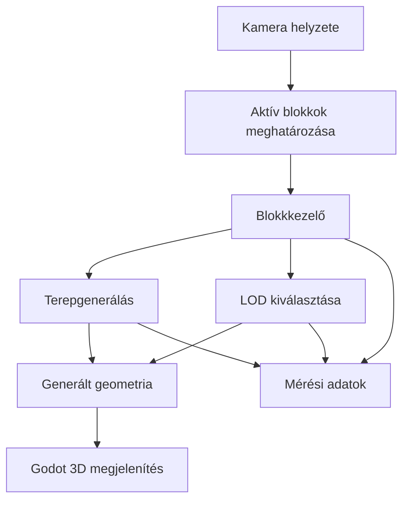

# Valós idejű procedurális terepgenerálás és a részletességi szintek kezelése

## 1. Szereplők és jogosultságok

| Szerep | Igény | Felelősség / hozzáférés |
| --- | --- | --- |
| Fejlesztő / hallgató | A terepgeneráló rendszer megvalósítása és vizsgálata | A rendszer fejlesztése, tesztelése, mérése és dokumentálása. |

## 2. Use case-ek / user storyk

### Procedurális terep megjelenítése és bejárása

- **Szereplő:** Fejlesztő / tesztelő
- **Előfeltétel:** A demonstrátor elindult, és a terepgeneráláshoz szükséges beállítások rendelkezésre állnak.
- **Fő folyamat:**
  1. A felhasználó elindítja a demonstrátort.
  2. A rendszer létrehozza a kamera környezetében szükséges terepblokkokat.
  3. A kamera mozgásakor a rendszer meghatározza, mely blokkok szükségesek.
  4. A szükséges blokkok betöltődnek, a már nem szükségesek eltávolításra kerülnek.
  5. A rendszer a saját LOD-szabályai alapján kiválasztja az egyes blokkok részletességét.
  6. A felhasználó megfigyelheti a terepet, és módosíthatja a vizsgálathoz szükséges paramétereket.
- **Alternatív / hibafolyamatok:** Ha egy blokk generálása késik, a rendszer fokozatosan vagy aszinkron módon dolgozza fel a feladatot. A még el nem készült blokk átmeneti megjelenítésének módját a megvalósítás során kell meghatározni.
- **Utófeltétel:** A kamera környezetében a szükséges terepblokkok megjelennek, a távolabbi vagy szükségtelen blokkok kezelése pedig a meghatározott szabályok szerint történik.

### Különböző generálási vagy LOD-megközelítések összehasonlítása

- **Szereplő:** Fejlesztő / tesztelő
- **Előfeltétel:** Legalább két összehasonlítható megközelítés és a mérési paraméterek rendelkezésre állnak.
- **Fő folyamat:**
  1. A felhasználó kiválasztja a vizsgált megközelítést.
  2. A rendszer azonos kiinduló beállításokkal előállítja és megjeleníti a terepet.
  3. A mérés rögzíti a generálási és frissítési időket, a memóriahasználatot és a geometria méretét.
  4. A felhasználó vagy a tesztelő megismétli a mérést a másik megközelítéssel.
  5. Az eredmények dokumentálhatók és összehasonlíthatók.
- **Alternatív / hibafolyamatok:** Ha a mérés közben a környezet vagy a beállítások eltérnek, az eredményeket külön kell jelölni, vagy a mérést azonos feltételekkel meg kell ismételni.
- **Utófeltétel:** A vizsgált megközelítések eredményei összehasonlítható formában rendelkezésre állnak.

## 3. Funkcionális követelmények

| Követelmény | Elfogadási kritérium | Prioritás |
| --- | --- | --- |
| A rendszer procedurális terepet generál. | A program indításakor a beállított paraméterek alapján terepgeometria jelenik meg. | Kötelező |
| A rendszer a terepet blokkokra bontja. | A terep külön kezelhető blokkokból áll, amelyek önállóan létrehozhatók és eltávolíthatók. | Kötelező |
| A rendszer a kamera helyzete alapján kezeli a blokkokat. | A kamera mozgatásakor a szükséges blokkok betöltődnek, a már nem szükségesek eltávolításra kerülnek. | Kötelező |
| A rendszer saját LOD-kiválasztást alkalmaz. | A blokk részletessége a dokumentált saját szabályok alapján változik. | Kötelező |
| Legalább két megközelítés összehasonlítható. | A kiválasztott megközelítések azonos mérési beállítások mellett futtathatók és eredményeik rögzíthetők. | Kötelező |
| A rendszer kezeli a fokozatos vagy aszinkron feldolgozást. | A blokkok generálása és kezelése nem kizárólag egyetlen, minden blokkot egyszerre feldolgozó lépésben történik. | Kötelező |
| A rendszer vizsgálja a szomszédos blokkok átmeneteit. | A különböző LOD-szintű szomszédos blokkok közötti látható rések vagy hirtelen átmenetek megfigyelhetők, és kezelésük vagy elemzésük dokumentált. | Kötelező |
| A rendszer mérési paramétereket biztosít. | A látótávolság, a blokkfelbontás, az aktív blokkok száma és a LOD-beállítások szabályozhatók vagy a mérési esetekben rögzíthetők. | Kötelező |
| A rendszer rögzíti a mérési eredményeket. | A generálási idő, a teljesítmény, a memóriahasználat és a geometria mérete dokumentálható. | Kötelező |
| A demonstrátor bemutatható állapotban futtatható. | A projekt dokumentált lépésekkel elindítható, és a fő funkciók kipróbálhatók. | Kötelező |

Prioritás: **Kötelező** = a teljesítéshez szükséges; **Ajánlott** = fontos, de a megvalósítás részleteitől függhet; **Lehetséges** = idő esetén opcionális.

## 4. Üzleti szabályok és korlátok

| Szabály vagy korlát | Indoklás |
| --- | --- |
| A terepgenerálás és a LOD-kiválasztás központi logikája saját megoldás. | A projekt szakmai hozzájárulása nem épülhet kizárólag a játékmotor automatikus terep- vagy LOD-rendszerére. |
| A blokkok előállításának azonos paraméterek mellett összehasonlítható eredményt kell adnia. | Ez szükséges az ismételhető és értelmezhető mérésekhez. |
| A különböző megközelítések összehasonlításakor a többi beállítást lehetőség szerint változatlanul kell tartani. | Így jobban elkülöníthető a vizsgált módszer hatása. |
| A mérések körülményeit és a használt paramétereket dokumentálni kell. | Az eredmények később megismételhetők és ellenőrizhetők legyenek. |
| A látható rések és a LOD-átmenetek problémáját kezelni vagy mérhető módon elemezni kell. | Ez a témakiírás egyik kiemelt követelménye. |
| A teljes nyílt világú játék és a hozzá tartozó játékmeneti funkciók nem részei a projektnek. | A munka a tereprendszer működésére és vizsgálatára összpontosít. |

## 5. Felhasználói felület és munkafolyamat

A demonstrátor elsődleges felülete egy 3D-s nézet, amelyben a kamera mozgatható, és a procedurálisan generált terep megfigyelhető. A fejlesztés során olyan kezelési lehetőségeket kell kialakítani, amelyekkel a fontosabb generálási és LOD-paraméterek módosíthatók, illetve a kiválasztott megközelítés tesztelhető.

A mérési munkafolyamat során a felhasználó beállítja a vizsgálat paramétereit, elindítja a generálást vagy a tesztet, majd rögzíti az eredményeket. A felület pontos kialakítása a prototípus elkészítése után véglegesíthető.

## 6. Nem funkcionális követelmények

| Követelmény | Ellenőrzés módja |
| --- | --- |
| A demonstrátor a dokumentált fejlesztői környezetben elindítható. | A projekt tiszta indításának ellenőrzése a README alapján. |
| A kamera mozgása közben a terep frissítése nem okozhat indokolatlanul hosszú megakadást. | Kamera mozgatása közbeni képkockaidő- és frissítésiköltség-mérés. |
| A mérési eredmények reprodukálhatók. | Azonos beállítások mellett végzett ismételt futtatások eredményeinek összehasonlítása. |
| A rendszer teljesítménye és memóriaigénye mérhető. | Generálási idő, CPU- és képkockaköltség, memóriahasználat, geometriai méret és blokkbetöltési késleltetés rögzítése. |
| A különböző LOD-szintek közötti vizuális átmenetek vizsgálhatók. | A szomszédos blokkok határainak megfigyelése és dokumentálása eltérő LOD-beállítások mellett. |
| A forráskód és a fejlesztési döntések követhetők. | Git-commitok, projektleírás és mérési dokumentáció ellenőrzése. |

A konkrét teljesítménycélokat a kezdeti prototípus és a fejlesztői hardver ismeretében célszerű meghatározni, hogy reálisak és mérhetők legyenek.

## 7. Nyitott kérdések és kockázatok

| Kérdés / kockázat | Hatás | Felelős | Feloldás / döntés |
| --- | --- | --- | --- |
| Melyik két generálási vagy LOD-megközelítést hasonlítsuk össze? | Meghatározza a rendszer felépítését és a mérési tervet. | Hallgató | A lehetséges módszerek áttekintése után kell kiválasztani. |
| Milyen szabály alapján választja ki a rendszer a LOD-szintet? | Befolyásolja a vizuális minőséget és a teljesítményt. | Hallgató | A kezdeti távolságalapú megoldás és egy eltérő stratégia összehasonlításának megvizsgálása. |
| Hogyan történjen az aszinkron vagy fokozatos generálás Godotban? | A rosszul szervezett feldolgozás képkockakimaradást vagy késleltetést okozhat. | Hallgató | Kis prototípussal megvizsgálni, mely munkafolyamatok végezhetők biztonságosan a háttérben. |
| Hogyan kezelhetők a különböző LOD-szintű szomszédos blokkok határai? | Látható rések vagy hirtelen geometriai átmenetek keletkezhetnek. | Hallgató | A lehetséges átmenetkezelési módszerek prototipizálása és vizsgálata. |
| Hogyan mérhető megbízhatóan a memóriahasználat és a geometria mérete? | Az összehasonlítás pontossága és értelmezhetősége függ tőle. | Hallgató | A mérhető adatok és a Godot által biztosított eszközök felmérése. |
| A választott megoldás megfelelő teljesítményt nyújt nagyobb terepen is? | A demonstrátor méretezhetősége korlátozott lehet. | Hallgató | A blokkfelbontás, a látótávolság és az aktív blokkok számának változtatásával tesztelni. |

## 8. Kezdeti technikai javaslat

### Javasolt megoldás

A kezdeti terv Godot játékmotorra és GDScriptre épül. A terep előállítása, a blokkok kezelése és a LOD-szint kiválasztása saját kódot használ. A Godot biztosítja a 3D-s megjelenítést, a kamera kezelését és az általános projektinfrastruktúrát.

A fejlesztés először egyetlen generált terepblokkal indul. Ezt követi a kamerához igazodó dinamikus blokkkezelés, majd a saját LOD-rendszer, a szomszédos blokkok átmeneteinek vizsgálata és a mérési funkciók kialakítása.

### Technológiai irány

| Terület | Jelölt technológia / megközelítés | Megfontolás oka | Nyitott kérdés / kockázat |
| --- | --- | --- | --- |
| Játékmotor | Godot | 3D-megjelenítés és általános játékfejlesztési infrastruktúra | A generált geometria és a sok blokk teljesítményét prototípussal kell ellenőrizni. |
| Programozási nyelv | GDScript | A Godothoz illeszkedő fejlesztési nyelv | A nagyobb generálási feladatok teljesítményét mérni kell. |
| Terepreprezentáció | Blokkokra bontott generált geometria | A blokkok külön generálhatók, frissíthetők és eltávolíthatók | A blokkfelbontást és a határok kezelését ki kell választani. |
| LOD-kiválasztás | Saját, paraméterezhető mechanizmus | Lehetővé teszi a különböző stratégiák vizsgálatát | A konkrét stratégiák még kiválasztásra várnak. |
| Feldolgozás | Fokozatos vagy aszinkron blokkfeldolgozás | Csökkentheti a generálás fő szálra gyakorolt hatását | A Godotban alkalmazható biztonságos munkamegosztást ellenőrizni kell. |
| Verziókezelés | Git és GitHub | A forráskód, a dokumentáció és a fejlesztési lépések követése | A mérési eredmények tárolási formáját meg kell határozni. |
| Mérés és dokumentáció | Rögzített tesztbeállítások és eredménytáblák | Az összehasonlítások ismételhetősége | A mérőszámok és a tesztesetek pontosítása szükséges. |

### Kezdeti architektúravázlat

### Megvalósíthatóság és technikai kockázatok

| Kockázat / feltételezés | Validáció | Tartalék megközelítés |
| --- | --- | --- |
| Egy terepblokk megfelelő sebességgel generálható. | Egyetlen blokk generálási idejének és geometriájának mérése több felbontással. | Egyszerűbb terepfüggvény vagy kisebb kezdeti felbontás használata. |
| A dinamikus blokkkezelés a kamera mozgásához igazítható. | Blokkok betöltésének és eltávolításának tesztelése egyszerű kameramozgással. | Kevesebb aktív blokk vagy nagyobb blokkbetöltési küszöb használata. |
| A LOD-szintek között kezelhetők a látható átmenetek. | Szomszédos blokkok vizsgálata különböző részletességi szinteken. | A hibák mérhető dokumentálása és egy egyszerűbb átmenetkezelési megoldás kipróbálása. |
| A generálás fokozatosan vagy aszinkron módon végrehajtható. | A generálás fő szálra gyakorolt hatásának összehasonlítása. | A feldolgozás kisebb lépésekre bontása és a blokkok korlátozott ütemű előállítása. |
| A kiválasztott módszerek eredményei érdemben összehasonlíthatók. | Azonos terepparaméterekkel és mérési körülményekkel végzett tesztek. | Kevesebb, de jól kontrollált teszteset használata.

